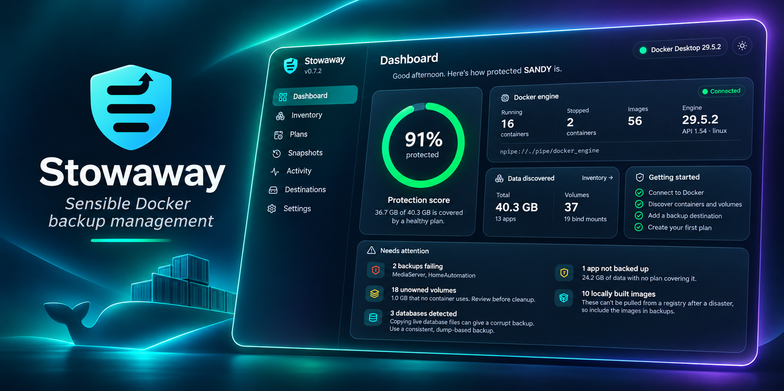

# Stowaway

**Sensible Docker backup management.**

Stowaway backs up the apps you run in Docker on a Windows computer (their volumes, their databases and their compose project folders) on a schedule, and restores them when you need to. It runs as a Windows service and you manage it from a web page at **https://localhost:8484**.

[](https://github.com/niogtres/stowaway/actions/workflows/ci.yml)
[](https://github.com/niogtres/stowaway/releases/latest)
[](LICENSE)

## What it does

- **Finds everything by itself.** Every container, compose stack, volume and bind mount, with sizes, live as Docker changes. Nothing to list by hand.
- **Backs up on a schedule.** Encrypted and deduplicated with [restic](https://restic.net), with retention ("keep 7 daily, 4 weekly…") and weekly integrity checks.
- **Keeps databases consistent without downtime.** PostgreSQL, MySQL/MariaDB, MongoDB and Redis are dumped with their own tools while they run, and SQL Server in Windows containers with its own `BACKUP DATABASE`. Apps it can't dump are stopped briefly, in the right order, and started again.
- **Backs up to where you want.** A second disk, a network share (SMB), S3-compatible storage, Backblaze B2, Azure Blob, SFTP, or Dropbox.
- **Restores files, volumes or whole apps.** Restore a single file, a volume to where it was (with an undo snapshot) or to a new one, or rebuild an app's containers, networks and data after a disaster.
- **Proves backups work.** Weekly restore drills restore into scratch space and load database dumps into throwaway containers, without touching your apps.
- **Tells you when something's wrong.** Protection status for every app, a tray icon, and alerts by email, webhook (Slack, Discord, Mattermost, or Teams through a workflow) or ntfy.
- **Secure by default.** Only this computer can open it, with Windows sign-in. Optional remote access, even over the internet behind a reverse proxy, needs a password and an authenticator app, and every change is in an audit log.

## Install

1. Download `Stowaway-<version>-x64.msi` from [Releases](https://github.com/niogtres/stowaway/releases) and run it. The installer isn't code-signed yet, so Windows may ask you to confirm (**More info** → **Run anyway**); the [install guide](docs/help/02-install.md#unsigned-installer) shows how to check the download against its `.sha256`.
2. Open **Stowaway** from the Start menu (https://localhost:8484).
3. Add a destination, create a backup plan, done.

See [Requirements](#requirements) for what it runs on. The [user guide](docs/USER-GUIDE.md) covers everything, including remote access and troubleshooting. The same guide is built into Stowaway under **Help**.

## Requirements

- **64-bit Windows:** Windows 10 or 11, or Windows Server 2022 or later. Stowaway itself is a Windows program (service, Windows sign-in, tray, installer); Windows on Arm is untested.
- **A Docker engine running Linux containers**, reachable from Windows:
  - **Docker Desktop** (the default; this is what Stowaway is tested with, on Windows 11).
  - **Docker Engine inside WSL 2**, for example on Windows Server where Docker Desktop isn't supported. Point Stowaway at it with the system environment variable `Stowaway__Docker__Endpoint` (or `DOCKER_HOST`), for example `tcp://localhost:2375`, and restart the service. Should work; not tested yet.
  - Other Docker-compatible engines (Rancher Desktop, Podman) may work; untested.
- **Or a Docker engine running Windows containers** (Docker Engine on Windows 10/11 or Windows Server). Volumes are backed up with restic running on the host, through a VSS snapshot when containers are running. SQL Server databases inside Windows containers (Business Central, for example) are backed up with SQL Server's own BACKUP DATABASE while they run, or copied out while they're stopped; other files a Windows container writes inside itself aren't backed up.
- **Not supported:** running Stowaway on Linux or macOS. It backs up Linux and Windows *containers*, but the computer running Stowaway must be Windows.

## Documentation

- [User guide](docs/USER-GUIDE.md): installing, backing up, restoring, remote access, troubleshooting.
- [Design](docs/DESIGN.md): architecture, security model and the decisions behind them.
- [Changelog](CHANGELOG.md): what changed in each release.
- [Contributing](.github/CONTRIBUTING.md): building from source, tests, pull requests.
- [Writing a provider](docs/PROVIDERS.md): adding a database or a destination type.
- [Security policy](.github/SECURITY.md): how to report a vulnerability.

## Building from source

Requirements: Windows 10/11, .NET SDK 10.0.1xx, Node.js 24, and Docker Desktop for the integration tests.

```powershell
dotnet tool restore
./build.ps1                                                # web UI -> tests -> self-contained publish -> artifacts/*.msi (version of the latest tag)
./build.ps1 -Version 1.2.3 -SignThumbprint <thumbprint>    # a specific version, Authenticode-signing the exe and the MSI
```

For development:

```powershell
dotnet run --project src/Stowaway.Service   # https://localhost:8484 (sign-in off in Development; data in %LOCALAPPDATA%\Stowaway-dev)
cd web; npm run dev                          # UI with hot reload on http://localhost:5173 (proxies /api)
dotnet test
```

If Stowaway is also installed on the same computer, the installed service already uses port 8484: stop it first, or give the development copy another port (`$env:Stowaway__Port = 8499`).

Built with .NET 10 (ASP.NET Core, Windows service), Docker.DotNet, React 19, Vite, Tailwind CSS, TanStack, WiX v5, and restic + rclone (in a runner container, or on the host for Windows-container engines). Third-party licenses: [THIRD-PARTY-NOTICES.txt](THIRD-PARTY-NOTICES.txt) (regenerate with `python -I tools/generate-notices.py`).

Brand artwork masters are in `assets/brand/`; `python -I tools/generate-brand-assets.py` regenerates the derived files (icon, favicon, installer images, illustrations).

## License

Copyright (c) 2026 Thomas Kraft. Released under the [MIT License](LICENSE).

"Docker" is a trademark of Docker, Inc. Stowaway is an independent project and isn't affiliated with or endorsed by Docker, Inc.
