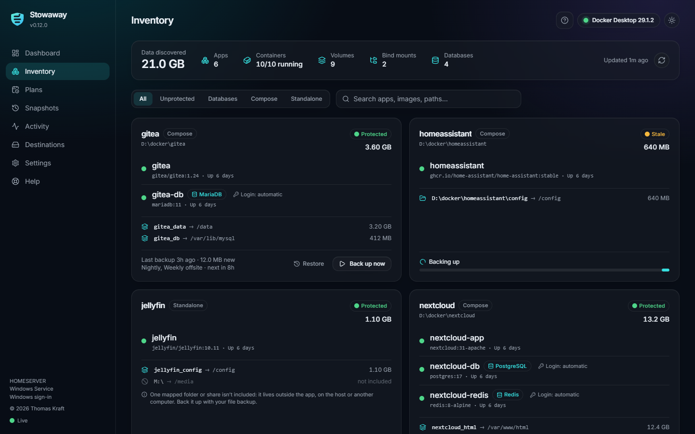
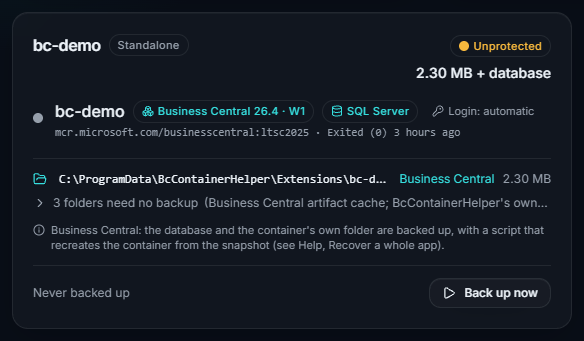

# Before you start

- **Windows:** 64-bit Windows 10 or 11, or Windows Server 2022 or later. Stowaway is a Windows program, so the computer it runs on must be Windows.
- **Docker:** with **Linux containers**: Docker Desktop (what Stowaway is tested with), or Docker Engine inside WSL 2 (for example on Windows Server, where Docker Desktop isn't supported). Or with **Windows containers**: Docker Engine on Windows 10/11 or Windows Server; Stowaway then runs restic on the computer itself and reads through a Windows volume shadow copy (VSS) while containers run. On Windows containers, keep data in volumes: files a container writes inside itself aren't backed up, except SQL Server databases (see [Plans](05-plans.md)). For an engine Stowaway doesn't find by itself, set the system environment variable `Stowaway__Docker__Endpoint` (or `DOCKER_HOST`) to its address, such as `tcp://localhost:2375`, and restart the Stowaway service.
- **What Stowaway backs up:** your apps. That means their Docker volumes, consistent dumps of their databases, and folders inside a compose app's project folder (such as `./data` or `./config`). Host folders mapped in from elsewhere, whole drives and network shares are **not** included: they live outside the app, so back them up with your normal file backup (File History, your NAS's backup…). Inventory marks them *not included*. A host folder that does belong with an app (such as its configuration) can be added with **Include** next to it; drives, system folders and shares can't.
- **Apps Stowaway recognizes:** for some products Stowaway knows which folders belong to the app. **Business Central** containers (made with BcContainerHelper) show their version on the card; their own `my` folder (setup scripts, certificates) is backed up automatically, and the folders that need no backup (the artifact cache, BcContainerHelper's shared folder, the hosts file) are folded into one line, *N folders need no backup*. Every snapshot of one also holds a script that recreates the container on another computer (see [Recover a whole app](08-recreate.md)).
- **Docker Desktop only runs while someone is signed in to Windows.** Backups that are due while Docker is stopped wait, and run once Docker is back. On a server, turn on *Start Docker Desktop when you sign in* and set up automatic sign-in, or use Docker Engine in WSL.
- **Somewhere to keep backups:** a second disk, a network share, or cloud storage (see [section 4](04-destinations.md)). A backup on the same disk as the data doesn't protect you from that disk failing.
- **An administrator account** to install it.

**See also:** [Install](02-install.md), [Destinations](04-destinations.md)
