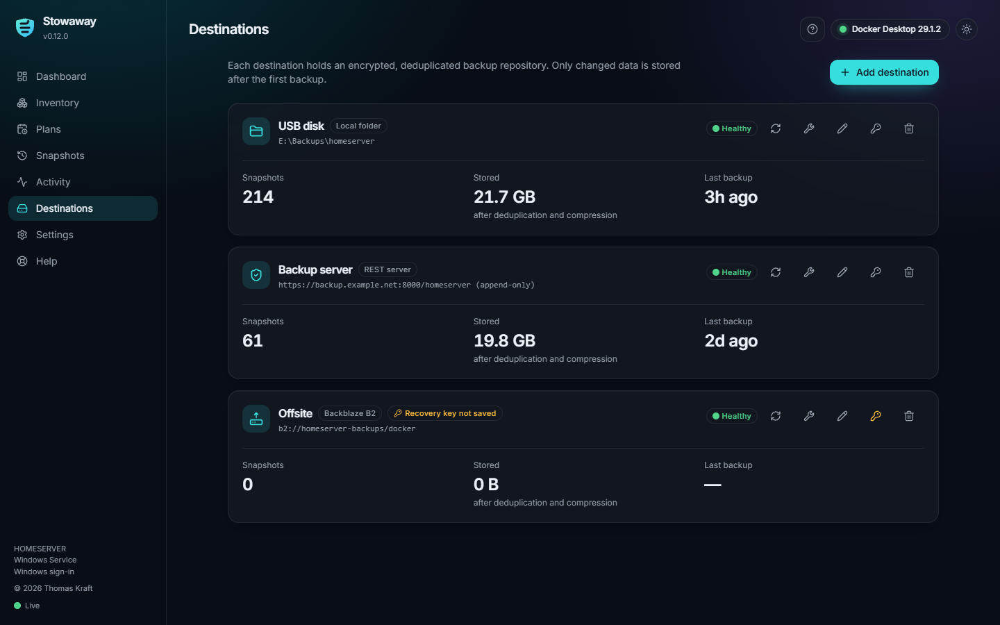
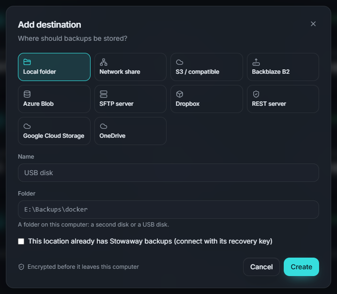
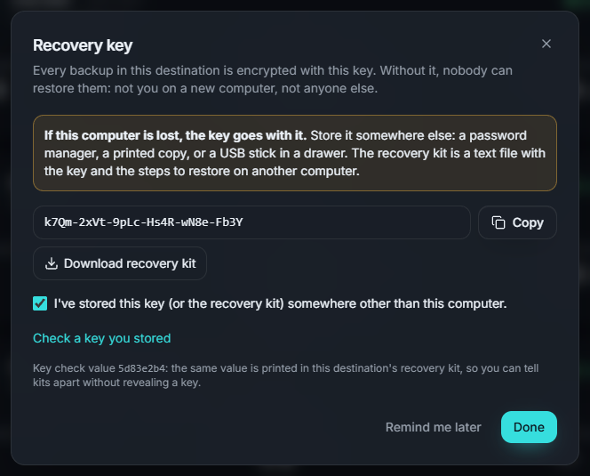

# Destinations

A destination is where backups go. Open **Destinations**, choose **Add destination**, and pick one:

| Destination | Use it for | You'll need |
|---|---|---|
| **Local folder** | A second internal or USB disk | A folder path such as `D:\Backups` |
| **Network share** | A NAS or another PC (SMB) | `\\server\share\folder`, a user name and password |
| **S3 / compatible** | Amazon S3, Wasabi, MinIO, Cloudflare R2… | Endpoint, bucket, access key and secret key |
| **Backblaze B2** | Low-cost cloud storage | Bucket, key ID and application key |
| **Azure Blob** | Microsoft Azure | Storage account, key and container |
| **SFTP server** | Any server you can SSH into | Host, user and an SSH key; the server's identity is remembered at setup and checked every time |
| **REST server** | restic's rest-server, for example on a NAS. Started with `--append-only`, it protects the backups from ransomware on this computer | The server's address, and a user and password if it asks for one |
| **Google Cloud Storage** | Google Cloud | Bucket, project ID and a service account key (JSON) |
| **Dropbox** | Your Dropbox account | Choose **Connect Dropbox** and approve access in the browser window that opens |
| **OneDrive** | Personal OneDrive, or OneDrive for work or school | Choose **Connect OneDrive** and approve access in the browser window that opens |

Backups are **encrypted** before they leave your computer. Each destination has its own **recovery key**:

> **Save the recovery key somewhere safe, away from this computer.** If this computer is lost, you need it (and the destination) to get your data back. Without it, nobody can read the backups, including you.

Adding a destination ends with this step: Stowaway shows the key, with **Copy** and **Download recovery kit**. The recovery kit is a text file with the key, where the backups are, and the steps to restore them on another computer, with Stowaway or with restic alone. Keep it in a password manager, print it, or put it on a USB stick in a drawer.

Tick **I've stored this key somewhere other than this computer** and choose **Done**. Until you do, the destination shows **Recovery key not saved**, and the dashboard lists it under *Needs attention*. **Remind me later** keeps those reminders. A destination you connected by typing in its key counts as saved.

- **Check a key you stored:** open the key button on the destination, choose **Check a key you stored** and paste it. Stowaway tells you whether it's this destination's key, which catches a key copied only in part, or one that belongs to another destination. A key that matches also counts as saved.
- **Which kit is which:** each kit and the key dialog show the same short *key check value*, so you can match kits to destinations without revealing any key.
- **Remote access:** keys are only shown, checked and confirmed on the computer that runs Stowaway, never through remote access.

## What you see at the destination

Because the data is encrypted, you won't see your own files at the destination. In a folder, in Dropbox or in OneDrive you'll see a `config` file and the folders `data`, `index`, `keys`, `locks` and `snapshots`. That is the backup. Browse and restore it from Stowaway. The destination list shows where each one is.

## Dropbox and OneDrive

- **Folder:** backups always go under `/Stowaway`. You can add a subfolder, for example `/Stowaway/server1`, to keep backups from several computers apart.
- **More than one destination in the same account:** when you add another one, choose **Same account as …** to reuse the sign-in you already have, and give it a different subfolder.
- **OneDrive for work or school:** your organization may have to allow the app *rclone* before you can sign in. If the sign-in page says you need an administrator's approval, ask your IT department. Stowaway keeps the sign-in current by itself; Microsoft ends unused sign-ins after 90 days, so a OneDrive destination that hasn't backed up for that long needs **Reconnect**.

### Connecting from another computer

When you use Stowaway through remote access, Dropbox or Microsoft can't send your browser straight back to the Stowaway computer, so there's one extra step:

1. Choose **Connect Dropbox** or **Connect OneDrive**. The sign-in page opens in a new tab. Sign in and allow access.
2. The tab then shows an error such as *"localhost refused to connect"*. That's expected. Copy the whole address from that tab's address bar. It starts with `http://localhost:53682/`.
3. Go back to the Stowaway tab, paste the address and choose **Finish**. Stowaway shows that the account is connected. The address works only once and for a few minutes; if it fails, choose **Start again**.

## REST server

[rest-server](https://github.com/restic/rest-server) is restic's own backup server. It's small, runs on most NAS systems and on any Linux computer, and has one feature none of the other destinations have: **append-only** mode.

- Started with `--append-only`, the server accepts new backups but refuses to delete or change existing ones. Ransomware or an intruder on this computer can't wipe your backups, even though Stowaway holds the password.
- Tick **The server is append-only** when you add it. Stowaway then doesn't remove old snapshots there (retention and the weekly clean-up are skipped, and the Activity log says so). Remove old snapshots on the server itself, from time to time, with `restic forget --prune`.
- If the server uses a certificate it made itself, paste that certificate under **Server certificate**. The connection is then still checked, rather than trusting any server.

## Google Cloud Storage

Create a service account for Stowaway (in the Google Cloud console: **IAM & Admin → Service accounts**), give it the **Storage Object Admin** role on the bucket, and add a key in JSON format. Paste the whole downloaded file into **Service account key**. Stowaway stores it encrypted. Delete the downloaded file afterwards.

## Editing a destination

Use the pencil button to rename a destination, change its password or keys, or reconnect Dropbox or OneDrive. **Change location** follows backups you have moved, for example a folder you moved in Dropbox or on the NAS. Stowaway only saves the new location if it holds the same backups, so an edit can't point a destination at different ones.

Older Dropbox destinations may sit in the root of your Dropbox. To tidy one up: move its `config` file and its folders into `/Stowaway` (or a subfolder) in Dropbox, then edit the destination and change its location to match.

## Removing a destination

Removing a destination only makes Stowaway forget it. The backups stay where they are, and you can connect them again with the recovery key. A destination that a backup plan still uses can't be removed: point the plan at another destination, or delete the plan, first.

**See also:** [Backup plans](05-plans.md), [Restore](07-restore.md)
