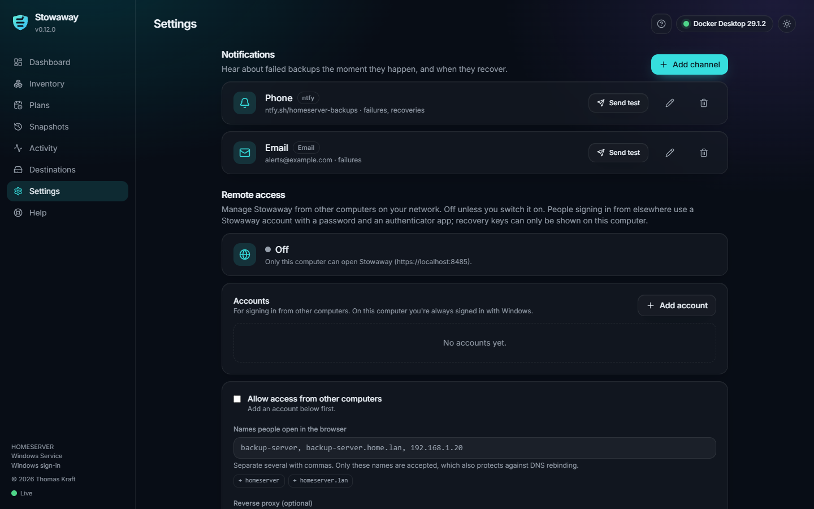

# Notifications

In **Settings → Notifications**, add a channel to hear about failed backups (and when they work again):

- **Email** (any SMTP server),
- **Webhook** (generic JSON, or Slack-compatible for Slack, Mattermost and Discord, where you add `/slack` to the webhook address; Microsoft Teams works through a Teams workflow that accepts a webhook),
- **ntfy** push notifications to your phone.

Channels that report failures also hear about security events when [remote access](12-remote-access.md) is on: a sign-in from a new address, a lockout, or a recovery code being used.

Use **Send test** to check a channel. Warnings and errors are also written to the Windows **Application** event log under the source `Stowaway`.

**See also:** [Watching backups run](06-activity.md), [Remote access](12-remote-access.md)
